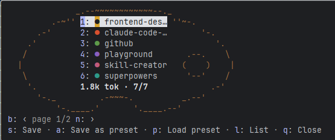

# Tavolozza

A Claude Code mod to pick which plugins are on, per project. Choose the right colours for your project.



Every enabled plugin adds always-on tokens to every session, even in a project where it is useless. Tavolozza (Italian for a painter's palette) adds a `/tavo` command that opens a pane with every installed plugin and the always-on token total of your selection. Toggle plugins, load a preset, check the dry run, and save: Tavolozza writes the choice to the project's `.claude/settings.local.json` and runs `/reload-plugins` for you. At session start it shows one line above the prompt with the folder's profile, as asdf does with `.tool-versions`.

Keys, presets, options and the full list of what Tavolozza reads and writes are in the [plugin README](plugins/tavolozza/README.md).

Requires Claude Code 2.1.287 or later, in the terminal or the desktop Code tab.

## Install

At the prompt of a terminal session:

```
/plugin install tavolozza --marketplace Psymboll/Tavolozza
```

From a shell: `claude plugin install tavolozza --marketplace Psymboll/Tavolozza`.

In the desktop app, where `/plugin` does not run: click **+** next to the prompt box, then **Plugins**, **Add marketplace** with `Psymboll/Tavolozza`, then **Add plugin**.

Then run `/tavo`.

## Develop

```
claude plugin validate plugins/tavolozza --profile directory
claude plugin test plugins/tavolozza
```

The plugin is the `plugins/tavolozza` folder; this repository is also its marketplace (`.claude-plugin/marketplace.json`).
