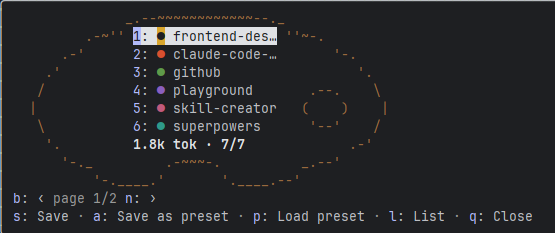

# Tavolozza

Pick which Claude Code plugins are on, per project, from inside the session.



Every enabled plugin adds always-on tokens to every session, even in a project where it is useless. Tavolozza (Italian for a painter's palette) is a Claude Code mod that adds a `/tavo` command. It opens a pane with every installed plugin, on or off, and the always-on token total of your selection. Toggle plugins, load a preset, check the dry run, and save: Tavolozza writes the choice to the project's `.claude/settings.local.json` and runs `/reload-plugins` for you. It never touches `.claude/settings.json` or your user settings, and it only switches plugins you already installed: it does not install, update or remove any.

When a session starts it puts one line above the prompt, as asdf does with `.tool-versions`. In a folder without a profile (no `enabledPlugins` in `.claude/settings.local.json`) the line is a reminder: press `1` in the empty prompt, or click *Choose plugins*, to open the pane. Once a profile is saved, the line is a summary of it, such as `custom · 3/7 plugins · ~1.2k tok · /tavo`, and Tavolozza speaks up again only when the installed plugins change. The pane itself opens only when you ask for it, unless you set *When to show at session start* to `always`.

Requires Claude Code 2.1.287 or later, in the terminal or the desktop Code tab. It is a Claude Code mod, so it does nothing in chat or Cowork.

## Install

At the prompt of a terminal session:

```
/plugin install tavolozza --marketplace Psymboll/Tavolozza
```

From a shell: `claude plugin install tavolozza --marketplace Psymboll/Tavolozza`. In the desktop app, where `/plugin` does not run: click **+** next to the prompt box, then **Plugins**, **Add marketplace** with `Psymboll/Tavolozza`, then **Add plugin**.

## Use

Run `/tavo`. The palette shows six plugins per page with the always-on token total under them, and the total follows your toggles. A `●` in its slot's colour is on, a dim `○` is off. The row under the board lists the actions with their keys:

| Key | Action |
| --- | --- |
| `1`–`6` (palette) / `1`–`9` (list) | toggle a plugin |
| `s` then `w` / `c` | save: show the dry run, then write or cancel |
| `a` | save the current selection as a preset |
| `p` | load a preset |
| `l` | switch between palette and list |
| `b` / `n` | previous / next page (shown only when there is a second page) |
| `q` / `Esc` | close |

**↑ / ↓** move between plugins and on to the actions, and in the terminal they turn the page when they go past the last plugin of one. **Enter** toggles the focused plugin. Run `/tavo` again to re-read settings from disk.

**Palette and list.** The list view also names the settings layer that decided each plugin (user, project, local, flag or policy) and marks the ones you changed with `*`. A plugin set by managed policy or a `--settings` flag is shown as locked and cannot be toggled. In the terminal the palette needs 47 columns and 11 rows; in a smaller pane Tavolozza shows the list, and goes back to the palette when there is room. With more than 24 plugins it opens in the list. In the desktop app the palette is a picture, with one button per plugin under it.

**Presets.** `lean` turns every plugin off and `full` turns every plugin on. `a` saves the current selection under a name of your own, and `p` loads any of them. To leave the name field without saving, choose *Cancel* or press Enter on an empty name. A preset only changes the selection in the pane: nothing is written until you save. Your presets are kept on your machine and are available in every project.

**Losing the keyboard.** The pane's keys work only while it holds the keyboard, so it closes when the keyboard goes elsewhere (a click on the prompt, `ctrl+x tab`). Toggles you had not saved are kept, and the next `/tavo` brings them back.

**Quiet at startup.** `/tavo snooze` keeps Tavolozza quiet when a session starts in this folder, `/tavo snooze week` does so for 7 days, and `/tavo unsnooze` undoes either. `/tavo` itself always works.

**Accessibility.** The terminal palette is ASCII art, which a screen reader reads character by character. Turn it off in `/config` → Tavolozza → *Palette view*, or press `l`: the list view states each plugin as `on` or `off` in words.

**Options** (`/config` → Tavolozza):

- *When to show at session start*: `always` (open the pane), `first-visit` (the reminder or the summary line), `on-change` (the default: also a notice when installed plugins changed since the profile was saved), `never` (only `/tavo`).
- *Palette view*: on by default; off gives the plain list.

## What it touches

- **Writes one file:** `.claude/settings.local.json` in the project root, and in it only the `enabledPlugins` key. Only the plugins whose state differs from your user and project settings are written. Every other key in the file is kept, a file that is not valid JSON is left alone, and nothing is written until you confirm the dry run.
- **Reads:** your user, project, flag and managed settings, to show which layer decided each plugin. It never changes them.
- **Runs:** `claude plugin list --json` and `claude plugin details <id>`, to list plugins and estimate their always-on tokens, and `/reload-plugins` after a save.
- **Remembers:** token estimates, your presets, your palette or list choice, and a per-folder record (when a profile was saved, snoozes). These live in Claude Code's own per-plugin store on your machine, never in the repository.
- **Network:** none. Tavolozza sends nothing anywhere.

The token total is an estimate: the tool schemas of a plugin's MCP servers are not counted. Tavolozza leaves itself out of its own list.

## License

MIT. Source and issues: <https://github.com/Psymboll/Tavolozza>.
